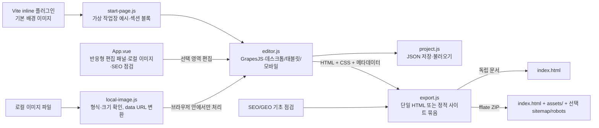

# page-builder 구조

| 파일 | 책임 | 테스트 |
|---|---|---|
| src/start-page.js | 처음 열 때의 가상 작업장 예시 페이지와 왼쪽 블록 목록 | 블록 id 중복 없음 |
| src/assets/forge-hero.webp | 편집기 시작 화면의 대장간 배경 | HTML·ZIP 내보내기 |
| src/inline-local-image-plugin.js | 기본 이미지를 개발·빌드 모두 data URL로 제공 | vitest |
| src/local-image.js | 로컬 이미지 형식·크기 확인과 data URL 읽기 | vitest |
| src/editor.js | GrapesJS 설정, 기기별 뷰포트, 스타일 섹터, 한국어 UI와 번들 자산 | 브라우저 확인 |
| src/project.js | 프로젝트 JSON 구성·검증 | vitest |
| src/seo.js | 메타데이터 구성과 본문 구조의 SEO/GEO 기초 점검 | vitest |
| src/export.js | SEO 메타데이터가 든 HTML, 이미지 자산을 분리한 사이트 ZIP | vitest |
| src/App.vue | 편집기, 작은 화면 패널, 이미지 추가, 프로젝트·SEO·내보내기 흐름 | 데스크톱·태블릿·모바일 확인 |

## 경계

- 편집기는 GrapesJS를 사용하고 이 저장소는 초기 템플릿, 로컬 파일 처리, 프로젝트 저장·내보내기만 소유한다.
- 입력과 편집 데이터는 브라우저 안에서만 처리한다. 프로젝트 JSON과 ZIP은 사용자가 직접 내려받는다. 자동 서버 저장, 업로드 API, 분석 전송은 없다.
- 편집한 로컬 이미지는 기본적으로 data URL로 프로젝트에 들어간다. 단일 HTML은 계속 선택할 수 있고, 사이트 ZIP은 이미지 파일을 assets/로 분리해 여러 파일로 내보낸다.
- 사이트 ZIP에 robots.txt와 sitemap.xml은 공개 사이트 URL을 제공한 경우에만 넣는다. 배포 서버, 도메인 소유권, 색인 상태는 이 앱이 설정하지 않는다.
- SEO/GEO 점검은 제목·설명·canonical·공유 미리보기, 시맨틱 제목 구조, 대체 텍스트와 설명 가능한 본문을 확인하는 편집 보조다. 검색 노출이나 AI 답변 수록을 보장하지 않는다. AI 전용 메타 태그 점수는 만들지 않는다.
- web-preview는 소스나 런타임 의존성으로 가져오지 않는다. 사용자가 내려받은 사이트 묶음을 각자 선택한 호스팅이나 미리보기 도구에 전달한다.
- 외부 CDN을 부르지 않는다. 편집기 CSS·아이콘·글꼴은 패키지에서 번들한다.

## 다음 단계

1. 저장된 프로젝트 형식의 버전 호환과 가져오기 오류 안내
2. 자주 쓰는 섹션 템플릿과 다중 페이지 사이트 구성
3. 내보낸 실제 파일을 모바일 브라우저와 주요 크롤러 도구에서 점검하는 안내
4. Tailwind 변환 등 별도 출력 형식은 사용 사례를 확인한 뒤 추가
