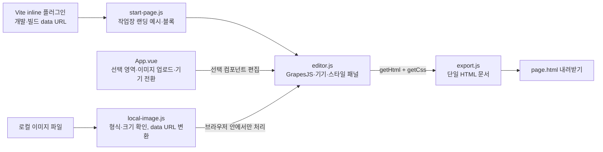

# page-builder 구조

| 파일 | 책임 | 테스트 |
|---|---|---|
| `src/start-page.js` | 처음 열 때의 작업장 예시 페이지(HTML·CSS)와 왼쪽 블록 목록 | 블록 id 중복 없음 |
| `src/assets/forge-hero.webp` | 편집기 시작 화면의 대장간 배경 이미지 | 단일 HTML 포함 테스트 |
| `src/inline-local-image-plugin.js` | 시작 이미지를 개발·빌드 모두 data URL 모듈로 제공 | vitest |
| `src/local-image.js` | 로컬 이미지 형식·크기 검증과 data URL 읽기 | vitest |
| `src/export.js` | 편집 결과를 HTML 문서 한 장으로 묶기, 파일 이름 정리 | vitest |
| `src/editor.js` | GrapesJS 설정(기기, 스타일 섹터, 한국어 문구, 번들한 아이콘·캔버스 글꼴) | 브라우저 확인 |
| `src/App.vue` | 편집기 껍데기, 이미지 업로드, 빠른 조절 막대, 기기 전환 | 브라우저 확인 |

## 경계

- 편집기는 GrapesJS를 사용하고 이 저장소는 초기 템플릿, 로컬 파일 처리, 내보내기만 소유한다.
- 업로드한 이미지는 브라우저 안에서 data URL로 변환한다. 서버로 전송하지 않고 내려받는 HTML 안에 포함한다.
- 내보낸 HTML은 외부 파일 없이 열린다. 편집기 전용 속성·스크립트는 남기지 않는다.
- web-preview는 소스나 런타임 의존성으로 가져오지 않는다. 단일 HTML 결과물은 별도의 미리보기 도구가 소비할 수 있는 교환 형식으로 유지한다.
- 편집 내용은 브라우저 밖으로 나가지 않는다. 현재 편집 상태는 브라우저 메모리에 두고 결과는 HTML 다운로드로 저장한다. 프로젝트 JSON 저장은 후속 작업이다.

## 다음 단계

1. 프로젝트 JSON 저장과 불러오기
2. 섹션 템플릿: 가격표, 자주 묻는 질문, 연락처
3. 작은 화면 미리보기에서 속성 패널을 다루는 흐름 개선
4. 내보내기 옵션: Tailwind 클래스 변환
