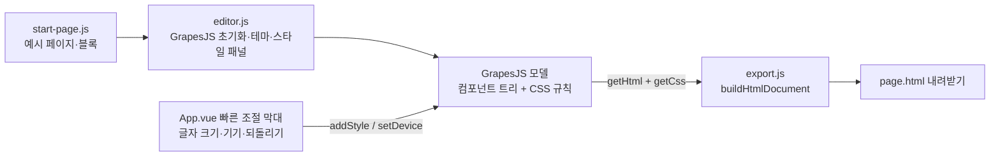

# page-builder 구조

| 파일 | 책임 | 테스트 |
|---|---|---|
| `src/start-page.js` | 처음 열 때의 예시 페이지(HTML·CSS)와 블록 목록 | 블록 id 중복 없음 |
| `src/export.js` | 편집 결과를 HTML 문서 한 장으로 묶기, 파일 이름 정리 | vitest |
| `src/editor.js` | GrapesJS 설정(기기, 스타일 섹터, 한국어 문구, 번들한 아이콘·캔버스 글꼴) | 브라우저 확인 |
| `src/App.vue` | 화면 껍데기와 빠른 조절 막대 | 브라우저 확인 |

## 로드맵

1. 프로젝트 JSON 저장과 불러오기 (`getProjectData` / `loadProjectData`)
2. 이미지 업로드(지금은 주소 입력만)
3. 섹션 템플릿: 가격표, 자주 묻는 질문, 연락처
4. 내보내기 옵션: Tailwind 클래스로 변환
